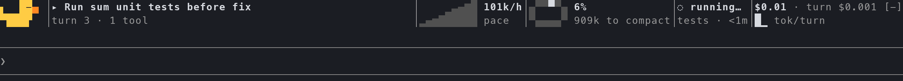
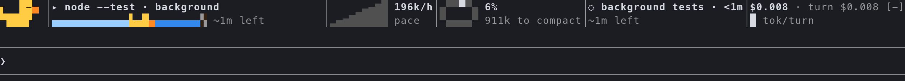
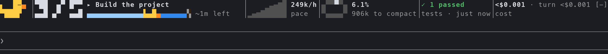
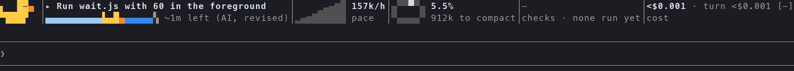
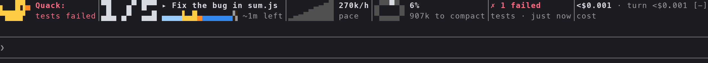
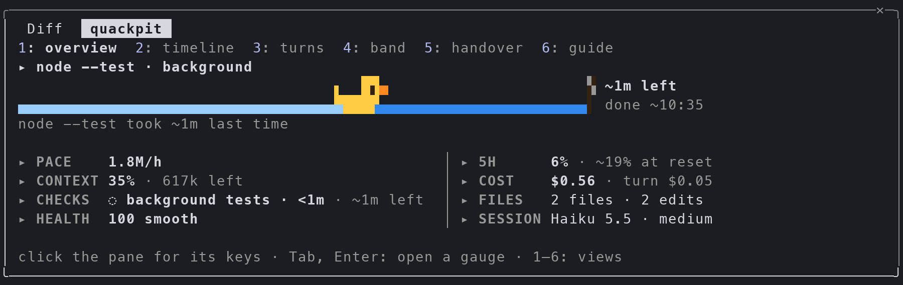
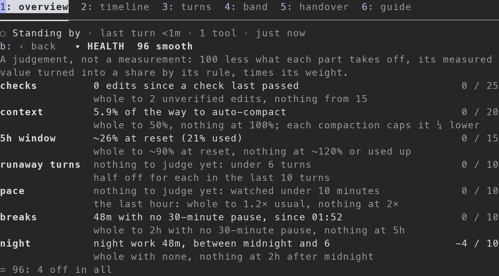

# quackpit

**A cockpit above your Claude Code prompt. The duck reads the gauges.**

[](CHANGELOG.md)
[](#requirements)
[](#privacy-and-reach)
[](LICENSE)

quackpit is one Claude Code mod that replaces a dozen single-gauge mods. It draws a live instrument panel in the band above the prompt: task progress, how long the work in hand will take (a duckling swimming to a flag), pace, context left before auto-compact, plan limits with forecasts, checks and cost. Its pane is six views under a header that stays in view; the overview is how long the work will take, then eight instruments of one size, like a cockpit's six-pack: your pace right now, a fuel gauge for your whole account's five-hour window, what fills the context (one bar, a colour a source), the cost of each turn, your checks by kind, the files edited, a judgement of how the work is going, and the session. Press any of them for what it is made of. A small rubber duck sits in the Master Caution slot. It stays asleep until something needs you, then wakes up and says **Quack:**.

It speaks English, Korean, Japanese and Chinese (simplified and traditional).

No quackery: every number comes from a real session event, and every measured estimate is marked `~`. The one estimate that is not measured, the opt-in AI ETA, always says it is the AI's.


<sub>A real Claude Code 2.1.296 session at 140 columns: Claude (Haiku) fixing a failing test, then running the full suite in the background. No task list: on Claude 5 models Claude Code does not offer its task tools unless you turn them on (see [How long it will take](#how-long-it-will-take)).</sub>

## Contents

- [Why quackpit](#why-quackpit)
- [Install](#install)
- [The band](#the-band)
- [How long it will take](#how-long-it-will-take)
- [The AI ETA (opt-in)](#the-ai-eta-opt-in)
- [The duck](#the-duck)
- [The pane](#the-pane)
- [Health](#health)
- [Handover](#handover)
- [Commands](#commands)
- [Configuration](#configuration)
- [Languages](#languages)
- [Privacy and reach](#privacy-and-reach)
- [Where it draws](#where-it-draws)
- [Limitations](#limitations)
- [Troubleshooting](#troubleshooting)
- [Development](#development)

## Why quackpit

- **One panel, not a dozen mods.** Progress, pace, context, limits, checks and cost sit side by side as tiles you can add, remove and reorder.
- **Knows how long.** quackpit estimates how long the work in hand will take from measured lengths: Claude's task list, the subagents it started and the background jobs it will come back to, ending at the latest of them. It shows the estimate as a duckling crossing a pond. Time spent waiting on you never counts, and the estimate keeps going after the turn ends while a background job runs. With nothing to measure, a long turn says how it compares with your usual turns. If you turn it on, Claude Haiku estimates the rest, and is asked again when the turn outruns its answer.
- **Free to run.** By default it spends zero model tokens, makes no network requests and starts no processes. It adds nothing to the model's context. The opt-in AI ETA is the one exception, and it counts every token it spends.
- **Honest numbers.** Readings come from Claude Code's own events and ledger. Forecasts come from real timestamps, are marked `~` and are only as precise as their data. The account dial says how old its readings are, and the AI ETA's accuracy is measured and shown, never promised.
- **Every number one press from its source.** Press an instrument in the pane and its detail shows what it is made of: each check run with its failing lines, what fills the context source by source, the turns by cost, the readings behind each dial and their age.
- **A panel, not a page.** The pane is views under a header that stays put, sized to the window, its instruments all one size; it keeps to the keyboard as well as the mouse.
- **Quiet by default.** The duck stays asleep and the pane never opens by itself. Colour appears only when a reading crosses a threshold.
- **Plays well with others.** quackpit keeps any other mod's band and draws its own rows beneath it, nearest the prompt.

## Install

### Requirements

- Claude Code **2.1.296 or later**, in a terminal or the desktop app. Mods (function hooks) are in early access, and their API can change between releases.

### From the marketplace

In a Claude Code session:

```
/plugin marketplace add imsungbin/quackpit-mod
/plugin install quackpit@quackpit
```

Or in one line: `/plugin install quackpit --marketplace imsungbin/quackpit-mod`. Pick a scope when asked (user is the usual one). The band appears at once. If the installer says some options are not set, the defaults are fine: `/config` changes them later.

To learn what each gauge means, run:

```
/quackpit help
```

It opens the pane with a guide beside the real gauges.

### Update, disable, remove

```
claude plugin marketplace update quackpit
claude plugin update quackpit@quackpit      # restart Claude Code to apply
claude plugin disable quackpit@quackpit
claude plugin uninstall quackpit@quackpit
```

### From a clone, for one session

```
git clone https://github.com/imsungbin/quackpit-mod ~/projects/quackpit-mod
claude --plugin-dir ~/projects/quackpit-mod
```

## The band



Six tiles are on after install, in this order:

| Tile | What it shows | Where the number comes from |
| --- | --- | --- |
| **progress** | With a task list: `done/total` in big digits, the current task, and a pond where a duckling swims toward a checkered flag, then `~2m left`. Without one: what the turn is doing (`Running pnpm test`, `Editing band.tsx`) and `turn 3 · 7 tools`, then, once a turn runs long, `longer than 90% of your turns`, or the AI ETA's `~8m left (AI)` if you turned it on. While Claude waits on you, where the band is in view (in a terminal Claude Code hides it behind the dialog, and the pane says it): `⏸ waiting on you · 1m05`, and nothing counts down. Between turns: the last turn at minute resolution, or the background work Claude will come back to (`make test-all · background`) with its time left. | Claude's own `TodoWrite`, `TaskCreate`, `TaskUpdate` and `TaskList` calls, its subagents and background commands, Claude Code's agent list, the estimate below, and the lengths quackpit has recorded. |
| **pace** | New tokens an hour right now against your usual pace (amber from 1.5×, red from 1.8×), and whether the 5h window lasts to its reset (`5h holds`) or when it empties at this pace (`empties 16:43`). "Right now" weighs each response by how recent it is, half as much 5 minutes on, so the figure falls while you are idle. | Each model response's usage as it arrives: input, output and cache writes count, while cache reads do not. "Usual" is the median of your last 14 days, or this session's own average until 3 past days are kept. |
| **context** | How full the context is, and how far it is to the auto-compact point (`84k to compact`), with compactions so far (`⟲1`). | Claude Code's own measurement after each turn, and its local estimate of where auto-compact starts. No request is sent for either. |
| **limits** | The 5h and 7d windows: percent used, a dim projection to the reset (`→ ~60%`, or `→ full ~16:43` when it runs out first) and a reset countdown (`↻2h12`). | The plan windows Claude Code reports. The 5h forecast is a least-squares line through the last 90 minutes of readings; the 7d forecast is the average so far. |
| **checks** | The last test, typecheck, lint or build Claude ran, and how it came out: `✓ 48 passed 3.1 s`, then `tests · 2 edits since` once files change after the last pass. While a check is failing, the failing run and its age, as the duck says it. A chain or a loop counts every check in it (`types+tests`). A check running in the background: `◌ background tests · 2m (usually ~4m)`. | The Bash call's exit status, the runner's summary line and the call's measured time (none when the call waited on a permission dialog); for a background run, the exit code in its notice. quackpit never runs anything itself. |
| **cost** | The session's cost, this turn's cost (`—` until the ledger has moved) and a tokens-per-turn sparkline. | Claude Code's own cost ledger (what `/cost` shows). |

Optional tiles: **agents** (subagents running, with their elapsed time), **files** (files edited, with edit counts), **session** (model, effort, permission mode, time up) and **health** (a judgement of how the work is going, from measured parts; see [Health](#health)).

Only Claude's own work counts. Tool calls and turns inside a subagent, and tool calls that other plugins make, never move a gauge. quackpit does watch subagents start and end, so the estimate knows what Claude is waiting for, but their tokens and tools are never counted.

When the terminal is narrow, the rightmost tiles switch to compact faces one by one. Below 80 columns, or with `rows 1`, the band becomes one dense row. Anything that still does not fit becomes a `+n` that opens the pane. Click any tile to open the pane on that tile's detail.

**The turn receipt.** Under Claude Code's own line at the end of each turn (`✻ Baked for 1m 4s`), quackpit adds a dim line with what the turn cost: `48k tokens · $0.41 · tests ✓`.

## How long it will take

quackpit estimates how long the work in hand will take and draws the answer as a duckling swimming across a pond to a checkered flag. The water behind it is pale; the water still to cross is blue. Its place is the work done over the whole, and the words beside it say what is left (`~2m left`) and, in the pane, when it should be done (`done ~16:40`).

> **Claude's task list needs Claude Code's task tools, and Claude Code 2.1.296 offers them only to Claude 4 models and older.** On the Claude 5 family (Opus 5.5, Sonnet 5.5, Haiku 5.5, Fable 5.1), Claude has no task list unless you start Claude Code with `CLAUDE_CODE_ENABLE_TODO_TOOLS=1` in its environment (or in the `env` of your `settings.json`). Without a list, quackpit still estimates the subagents and background jobs Claude runs, and the opt-in AI ETA covers the rest of a long turn; the README's main animation shows a session without one. quackpit reads whichever task tools Claude has: `TaskCreate`, `TaskUpdate` and `TaskList`, or `TodoWrite`.

The work in hand is everything Claude will finish or come back to, and each part has a measured length:

- **Tasks** run one after another, each at the length a task is expected to take: the median of this list's finished tasks once two are done, and before that the median of your recent tasks (this session's earlier lists and your sessions of the last week).
- **Subagents** Claude started, in the foreground or the background, run to the usual length of their type (Explore, general, and so on), from their finished runs. A type that has never finished runs to the usual length of all subagent runs, and says so; with no runs at all, it is listed as running with no expected end and adds nothing.
- **Background jobs.** A command Claude runs in the background runs to the median of its last runs in this project (one is enough), else, for a test, typecheck, lint or build, to that kind of check's usual length. A dev server, which has neither, is listed as running and adds nothing; after its first 30 minutes it gives the headline back and runs on as one quiet line (`pnpm dev · background 2h05`). A monitor or a workflow Claude starts is followed from its call.
- **The AI's answer**, if you turned the AI ETA on, covers the rest of the turn.

The whole ends at the latest of them: parts that run at once are never added up, and none replaces another. When a part runs over, it gets half its usual length more, a minute at most, rather than an end in the past.

**Waiting on you is not work.** When Claude asks you a question, shows you its plan or waits for your OK in a permission dialog, the pane says `⏸ waiting on you · 1m05` and what it waits for, the duckling holds still, and nothing counts down. (In a terminal Claude Code draws no band while a dialog is open, so the pane is where a wait shows.) When you answer, every end that waited moves later by the wait. Waits are left out of every length quackpit records (tasks, subagents, turns and the working time), so a slow answer never makes the next estimate longer. An ask that auto mode or a hook settles by itself is no wait.


**After the turn ends**, the background work Claude will come back to keeps the estimate going. The band names it in place of Standing by (`node --test · background`, by its command where that reads as one) with the time it has left, and when the job's notice starts Claude's next turn, the duckling carries on across the same pond. A background check counts as a check: its exit code passes or fails it, and a failure wakes the duck.



The estimate uses only measured lengths, never Claude's own words about time, and it is always marked `~`. Before anything has been measured, the duckling moves with the tasks done instead, with no time beside it. When tasks are added the far shore moves away and the duckling slips back, which is what the estimate says. A finished list puts the duckling at the flag, unless a subagent or a background job of Claude's is still running.



**Every subagent, listed.** The pane's timeline lists every subagent in the session with who started it: Claude, a workflow, another subagent, a plugin, or a teammate. Only the ones Claude started (and a workflow's) count in the estimate; the rest say `not counted`. A teammate idle between its turns, or an agent waiting on its own work, is alive but not running: the progress and AGENTS, which read the same answer, count it in one quiet line (`3 teammates idle`), never as running work. quackpit reads Claude Code's agent list as turns start and end, and every 5 seconds while one runs or waits, so a subagent it did not see start, such as a skill's fork, is listed too.

**With no list, a fact instead of a countdown.** Most turns have no task list, and their lengths vary widely, so quackpit does not guess a time for them. Once a turn has run longer than half of the turns it has recorded (20 at least, from this session and your recent ones), the hero says so: `longer than 90% of your turns`, rounded down, or `longer than any of your last 30 turns`.

## The AI ETA (opt-in)

Off by default. Turn it on with:

```
/quackpit ai on
```

or with the **AI ETA** row in `/config`. `/quackpit ai off` turns it off, and `/quackpit ai` says how it stands and what it spent today.

While it is on, once a turn has worked a minute with nothing measured covering its own work (a task list's pace, or a subagent of a known length it waits on), quackpit asks Claude Haiku, in the background, how many more minutes the turn will run. The answer shows as `~8m left (AI)` in the band and the pane. It is one part of the whole: a subagent or a background job expected to end later still sets the end, and the duckling's pond follows whichever ends last.



**It asks again** when the turn outruns its answer (by 30 seconds or half the answer, whichever is more), after you answer a question or a permission dialog, and when the work changes shape: a subagent or a background job starts or ends, a task list appears, or the measured estimate it deferred to goes away. A re-ask tells Haiku its earlier answers, what happened since and Claude's latest words, and asks it to keep its estimate unless those change it. A revision shows as `~4m left (AI, revised)`, and the pane says what it rests on: `Haiku's 2nd guess at 10:49 (1st ~2m) · not measured`. Past an answer with a re-ask due, the band says `past the AI's ~2m · asking again`.

- **Its limits:** 4 calls a turn at most. The second waits at least 2 minutes after the first, the third 4 minutes after the second, the fourth 8 minutes after the third. No call goes out while another is out or while Claude waits on you; the turn's end cancels one not yet answered, and an answer made for a state the turn has since left (you were asked something meanwhile, or the work changed shape) is dropped.
- **What it sends:** the prompt the turn began with (credentials masked, long text cut to its head and tail), what Claude has said so far this turn (its stated plan), the task list if there is one, how long the turn has worked, and your usual turn lengths for calibration; on a re-ask, also its earlier answers and what happened since. Nothing else: no files, no transcript.
- **What it costs:** each call is one `$.model.complete` call: model `haiku`, effort `low`, a few tokens of reply, a 10-second limit, cancelled if the turn ends first. A call is a few hundred tokens (a live one reported 294 in and 179 out, its thinking included). The pane counts every call's tokens, as its own usage reports them, today and over the last 7 days. It shows tokens, not dollars: there is no price reading for these calls.
- **What it never does:** it is a completion of its own, so nothing is added to your conversation's context, and it never forks your session.
- **How good it is:** when a turn it answered ends, quackpit compares each answer with the time that was really left, beside the history-only estimate made at the same moment (the median of your recorded turns that ran longer). First answers and revisions are scored apart, since a revision comes later with less left to get wrong. Once 20 first answers are scored, the pane shows how often each landed within 2×. Only numbers are kept, never the prompt or the reply.

Its reply must be a number alone; anything else draws nothing.

## The duck

The duck is quackpit's Master Caution: an original pixel rubber duck at the left of the band. It sleeps and never animates while idle. When something needs you, it wakes, quacks once (a short beak flap) and the cell says **Quack:** with the cause, in every language:

| Cause | When |
| --- | --- |
| A failed check | The latest run of a test, typecheck, lint or build failed. |
| The 5h window | It reaches 80% and will not last to its reset. A window that resets within 30 minutes and will last until then raises nothing. |
| The context | It reaches 90% of the way to the auto-compact point (`Quack: 11k to compact`). |
| A runaway turn | A turn costs over 3× the session's median turn, after 5 turns. |



A command that you refused, that a rule blocked or that you stopped with Esc never failed, so it raises nothing.

Each new caution shows one toast. A failed check and the 5h window at 90% send an OS notification instead, at most 3 a day across all your sessions. Click **Quack:** to acknowledge a caution; the gauge stays amber or red until the cause clears. An optional quack sound is off by default. `/quackpit duck off` removes the duck and its toasts, and the gauges still change colour.

When the context gets long (past 200k tokens, or 400k in a window larger than 200k, or 80% of the way to auto-compact, whichever comes first), the hero says `shift change soon · /quackpit handover` once.

## The pane

`/quackpit` opens the pane, and so does a click on any tile in the band, which opens it on that tile's detail. It never opens by itself.

The pane is six views: **overview**, **timeline**, **turns**, **band**, **handover** and **guide**. A bar of them stays on top, keyed 1 to 6, with a heavy rule under the one in front; a line at the bottom names the keys of the view in front. Outside the overview, the progress stays in view as one line under the bar: the list's count, the duckling's pond, the time left and what is being done. In a terminal the body between them scrolls on its own, so the bar and the progress never scroll away.


### The overview

**Progress** across the top: how long the work in hand will take. The task running, the list's count in big digits, the duck crossing to its flag, the time left (`~2m left`) and when it should be done (`done ~16:40`), and what that rests on, the part that ends last first (`2 open, ~1m each · at this list's pace`, `make test-all took ~4m last time`, `Haiku's 2nd guess at 10:49 (1st ~2m) · not measured`). A part with no length known gets a line of its own (`general · running 3m, no usual length yet`). While Claude waits on you, how long it has waited and what for. With no list, what the turn is doing and how it compares with your turns. After the turn, while background work runs, its name and time left; with nothing running, a line: `✓ All 5 done · last turn 4m · 5 tools · 1 min ago`.

**Eight instruments** under it, all one size: a title that is its press, a graphic about four rows tall, and its words beside it. Every graphic draws a real reading, and colour appears only past a threshold, except in the context's bar, where a colour is a key to a source.

| Instrument | Its graphic | Its words |
| --- | --- | --- |
| **PACE**, this session | A dial from 0 to twice your usual pace. The needle is new tokens an hour right now (cache reads left out), each response counting half as much 5 minutes on, so it falls while nothing runs. The mark outside the rim at its top is your usual. Amber from 1.5×, red from 1.8×. | The pace, how it compares (`1.3× usual`, or `1.3× this session's average` until 3 past days are kept), your usual or `idle 7m`, the cache's share. |
| **5H WINDOW**, whole account | A fuel gauge, 0 to 100% used, with one needle for what is used. The thin grey arc outside the rim runs from the needle to where the trend says the window will stand at its reset. Amber from 80% used, red from 90%. | `15% used`, `~17% at reset` (or, in amber, `runs out ~11:55` and how long before the reset), `resets 12:40`, and how old the readings are; a seven-day window that will run out first, in amber (`7d out in ~2d9h`). |
| **CONTEXT** | One bar across the cell for the whole window: what is used, source by source in fixed colours, then the free space as dots and the compaction buffer hatched, so the auto-compact point is where the dots end. The sources: **setup** (the system prompt, tools, MCP, custom agents, memory files and skills, as `/context` counts them), **chat** (your prompts, Claude's replies, a compaction's summary), **thinking**, **file reads**, **edits**, **commands**, **agents**, **web** (web and MCP results) and **other** (Claude Code's own notes, other tools). The whole cell, no graphic beside it. | Above the bar, the fill and the tokens left to auto-compact (`42% · 83k left`, amber from 70% of the way, red from 90%); under it the three largest sources, a swatch and a name each, no numbers; then the compactions so far. |
| **COST** | A column a turn, in dollars once Claude Code priced every turn shown, scaled to three times your median turn: a full column is a turn that ran away (amber). | The session's cost, this turn's, the median turn's. |
| **CHECKS** | A row a kind of check that ran (test, type, lint, build), a square a run, newest on the right: green a pass, red a failure, hollow a run stopped or whose result was cut away, ◌ one running. | The run the duck would name and its result, when it ran, the runs' tally, the edits made since a check last passed. |
| **FILES** | A thin bar a file, the most edited first, then its name and count; a file edited since the last passing check has its bar in full ink. | How many files and edits, in the title. |
| **HEALTH** | A dial of the score, 0 to 100. Its needle turns amber under 70 and red under 50. | The score and its word, its weakest part, and that it is a judgement (see [Health](#health)). |
| **SESSION** | None: words at the same height. | The model and effort, the permission mode, time up and working, turns and the project. |

Once a subagent has run, a ninth instrument, **AGENTS**, lists how many of Claude's agents run, the first of them with its time left, and the finished ones; teammates idle between their turns and agents waiting on their own work are one quiet line (`3 teammates idle · 1 waiting`), never running. Under the instruments, one line of cautions appears when there are any: `Quack: tests failed · 5h window 82%`. Press it to acknowledge them, as you would the duck's `Quack:` in the band.

Plan limits are your account's, so the five-hour gauge covers your other sessions, other machines and claude.ai too. Its readings arrive only with this session's own responses, so it always says how old they are, and its needle turns grey after 15 idle minutes.

### Details: press an instrument

An instrument's title (`▸ CHECKS`) is a press. Its detail takes the overview's place, under a `b: ‹ back` press: press it, or **b**, to go back, and the keyboard lands on the instrument you came from. Where the pane is 90 columns wide or more, the detail opens beside a list of the instruments, one line each, the open one marked `▾`; press another to switch. A tile pressed in the band, or `/quackpit <tile>` (`/quackpit health`), opens the overview on that detail.


| Detail | What it shows |
| --- | --- |
| **pace** | The pace now and how it is weighed, the last hour as columns and its sum, your pace against your usual and where the usual comes from (your last days, or this session's own average), the dial's scale, the cache's share and how old the latest response is. |
| **5h window** | How much is used, where the trend ends at the reset or when it runs out, when it resets and how far into its five hours it is, its rate and what the rate means (below), the readings behind it with their times, the seven-day line, and how old they are. |
| **context** | What fills it: every source with its tokens and share, the largest first; setup's own rows (system prompt, tools, MCP by server, custom agents, memory files, skills); the largest single parts (`Read src/model.ts ~9k`); each turn's size as it ended (amber past 70% of the way, red past 90%) and when each compaction came; the tool schemas loaded on demand, outside the window; and how the split is measured. The total and setup are Claude Code's own count; the split of the rest is quackpit's estimate, by the size of each part of the conversation, and carries `~`. |
| **cost** | The turns priced, the median turn, the five dearest turns with their factor and words, and tokens per turn. |
| **checks** | Every run of this session, newest first: its kinds, verdict, time taken, when it ran, its command, and a failed run's failing lines. |
| **files** | Every edited file with its edit count, marked new or unverified (edited after the last passing check). |
| **agents** | Every subagent run: its type and task, how long it ran (waits on you left out), its tokens, tools and lines changed. |
| **session** | The model, effort and permission mode, time up and working time, turns, and the project. |
| **health** | Every part of the score: what it measured, its rule, its weight and what it took off (see [Health](#health)). |


**What `+8 points an hour` means.** The five-hour detail gives the window's rate as `+8 points an hour (the last 90 minutes, whole account)`: a line through the readings of the last 90 minutes says the window has been filling by 8 of its 100 points an hour, counting every session, device and claude.ai on your account. Before 3 readings 10 minutes apart are in, it is the window's average since it opened. The gauge does not show the rate; it shows where the rate leads (the grey arc).

### The other views

| View | What it holds |
| --- | --- |
| **timeline** | Time since the session began, time spent working (waits on you left out), turns and cost; the prompt cache's clock (`warm: 48m left (1h cache)`, or what the next prompt will rewrite once it is cold); your waits; and each task, subagent and background job on one time axis, so you can see what ran at once. The tasks still to come are drawn where the estimate expects them, with `~1m` each; a running subagent or job shows its expected end, or `no usual length yet`. Each subagent says who started it, and those Claude did not start say `not counted`. |
| **turns** | The mission (your first prompt, the session's goal), the AI ETA's calls and tokens and how its first answers and its revisions scored (when you use it), then the last 20 turns with their working time, tokens, cost, tools and edits, and what started each. Press a turn to scroll the transcript to it. |
| **band** | Remove a tile (`×`), add one (`+`), and **reset to default** once the band differs from your settings. |
| **handover** | Write and copy the handover, and the note itself. |
| **guide** | What each part means, why the duck quacks, and the commands. `/quackpit help` opens it. |

### Keys, mouse and commands

- **Mouse:** click a view's name, an instrument's title, a turn, or `‹ back`. The wheel scrolls the view.
- **Keyboard:** click anywhere in the pane to give it the keyboard (the line at the bottom says so until you do). Then **1** to **6** bring up the views, **Tab** and **shift+Tab** walk the presses, **Enter** presses, **b** goes back from a detail, **↑↓** and **PgUp PgDn** scroll a view longer than the window, and **Esc** gives the keyboard back to the prompt and leaves the pane open. Whenever a view changes, the keyboard is put on the view bar first, so Enter never presses something that moved under it.
- **Command:** `/quackpit view turns` (or a number, `/quackpit view 3`), or the view's name alone: `/quackpit turns`.

### Sized to the window

The pane docks to the right where the terminal is wide enough, as wide as the terminal less 85 columns for the transcript (56 to 96 columns), unless you have given it a width yourself. The overview takes the largest form that fits: full instruments where two of 33 columns fit across, smaller ones (3-row graphics) from 55 columns, then compact cells, then a line each; progress gives way to its one line before the instruments get smaller still. Below 110 columns the pane sits above the prompt as a smaller view, about a third of the terminal's height (Claude Code sizes it): progress, then the instruments a line each, two across from 70 columns.



The pane remembers the view and the detail you left through a reload and `/clear`, and opens on them in your next session. `/quackpit`, its close mark or ctrl+x x close it.

## Health

An instrument of the pane, and an optional tile for the band (`/quackpit add health`), that answers one question: is the way this work is going healthy? It is a score from 0 to 100 with a word for its state: **smooth** from 85, **light chop** from 70, **choppy** from 50, **turbulent** below. It turns amber under 70 and red under 50, and its second line names its weakest part (`4 edits unverified`, `context 96%`, `night work 1h30`).



**It is a judgement, not a measurement.** quackpit measures the parts; how much each one matters is a choice, and the score says so. Press the tile, or the instrument in the pane, and every part is there with its measured value, its rule, its weight and the points it took off.

The formula: **health = 100 − Σ weight × (1 − share)**, where each part's share runs in a straight line from 1 (whole) to 0 (nothing):

| Part | Weight | Measured | Whole at | Nothing at |
| --- | --- | --- | --- | --- |
| **checks** | 25 | Edits no passing check has seen since | 2 edits or fewer | 15 edits |
| **context** | 20 | How far the context has come to its auto-compact point (or the window's end) | 50% | 100%; each compaction this session caps the share ¼ lower |
| **5h window** | 15 | Where the account's window will stand at its reset, at its trend | ~90% | ~120%, or used up |
| **runaway turns** | 10 | Turns that cost over 3× the session's median, in the last 10 | none | two; one takes half |
| **pace** | 10 | This session's new tokens over the last hour against your usual | 1.2× | 2× |
| **breaks** | 10 | How long you have been prompting with no 30-minute pause | 2 hours | 5 hours |
| **night** | 10 | How much of that stretch fell between midnight and 6 | none | 2 hours |

Health's pace reads the last hour rather than the pace now: a score that moved with every response, and went back to whole in every pause, would judge nothing. The points taken off are rounded so they add up to the score exactly. A part with nothing to judge yet counts whole and says why: no check has run yet (a project may have none), no usual pace yet, fewer than six turns. Breaks and night read your own prompts, not Claude's turns: a long turn Claude works through alone is no proof you sat through it, and a `/clear` does not end your stretch.

Health covers this session. It never calls a model, reads nothing from any other plugin, and never wakes the duck: the duck is for what needs you now, and the parts that do (a failing check, the context near compaction, the window, a runaway turn) have cautions of their own. In the pane it is always one of the eight instruments, saying `not judged yet` until it has anything to judge.

## Handover

`/quackpit handover` writes `.claude/handover.md` in your project, copies it to the clipboard and shows it in the pane. It is built from this session's events alone, with no model and nothing summarised. It has these sections:

- **Mission**: the goal (your first prompt) and the task list, done and open.
- **Your words**: the prompts you typed after the goal, in order (each cut to 300 characters), and your last prompt in full, so constraints you gave along the way are not lost.
- **Waiting on you**: a question Claude's last answer left open, if any.
- **Telemetry**: files edited, commands run with pass or fail, tokens and cost.
- **How to run**: the commands that last passed for each kind of check.
- **Unverified**: files edited after the last passing check.
- **Anomalies**: failed checks, runaway turns and compactions.
- **Next shift**: the open tasks verbatim, and the failing output of each check still failing.

You paste the handover into a new session yourself; quackpit never submits it anywhere. Credentials in prompts, task titles, commands and output are masked as quackpit takes them in, so they reach neither the band nor the file. Masking is best effort.

## Commands

| Command | Does |
| --- | --- |
| `/quackpit` | Opens or closes the pane. |
| `/quackpit view <name\|1-6>` | Opens the pane on a view: `overview`, `timeline`, `turns`, `band`, `handover` or `guide` (`/quackpit turns` works too, and `tab` for `view`). `/quackpit view` lists them. |
| `/quackpit <tile>` | Opens the overview on a tile's detail (`/quackpit health`, `/quackpit checks`). |
| `/quackpit add <tile> [n]` | Adds a tile, at the end or at position `n`. |
| `/quackpit remove <tile>` | Removes a tile. |
| `/quackpit move <tile> <n>` | Moves a tile to position `n` (1 is leftmost). |
| `/quackpit rows <1-4>` | How many rows the band may take. 2 (the default) is one line of tiles; 3 adds a dense row for tiles that did not fit; 4 wraps the tiles onto two lines; 1 is the dense row alone. |
| `/quackpit reset` | Puts the band back as your settings have it (the six tiles, 2 rows and the duck, unless you changed them in `/config`). The pane's **reset to default** button does the same. |
| `/quackpit handover` | Writes and copies the handover, and opens its view. |
| `/quackpit duck on\|off` | Shows or removes the duck. |
| `/quackpit ai on\|off` | Turns the AI ETA on or off (the same setting as its row in `/config`). `/quackpit ai` says how it stands and what it spent today. |
| `/quackpit help` | Opens the pane on its guide: what each part means (also `guide` and `?`). |

`/quack` is the same command. Tiles: `progress`, `pace`, `context`, `limits`, `checks`, `cost`, `agents`, `files`, `session`, `health`. Your layout is kept across sessions until you change the matching setting in `/config`; then the setting wins.

## Configuration

Every option is a row in `/config`:

| Option | Default | Meaning |
| --- | --- | --- |
| `tiles` | `progress,pace,context,limits,checks,cost` | The band's tiles, in order; `agents`, `files`, `session` and `health` can be added. A name that is not a tile is refused, with the list of tiles. |
| `rows` | `2` | Rows the band may take, 1 to 4. |
| `duck` | on | The duck in the Master Caution slot. |
| `sound` | off | Quack out loud when the duck wakes (macOS plays it). |
| `graphics` | `auto` | `auto` draws pixel gauges where the terminal shows images (kitty, Ghostty) and designed text elsewhere, where the pane's dials are quadrant blocks. `pixels` or `text` forces one; with `text` the dials are text too. |
| `locale` | `auto` | `auto` (your system locale), `en`, `ko`, `ja`, `zh-Hans` or `zh-Hant`. |
| `aiEta` | off | The AI ETA: ask Claude Haiku how long a long turn with nothing measured has left, and again when the turn outruns the answer or the work changes, 4 calls a turn at most. Its tokens are counted in the pane. |

**claude-hud users.** On first run, if a claude-hud config exists (`~/.claude/plugins/claude-hud/config.json` or `~/.claude/claude-hud.json`), quackpit maps the lines you keep on to tiles and says so once. It only reads those files.

## Languages

The band, the pane, toasts, notifications, the guide and the handover are in **English**, **Korean** (한국어), **Japanese** (日本語), **Simplified Chinese** (简体中文) and **Traditional Chinese** as Taiwan writes it (繁體中文). With `locale` set to `auto`, quackpit follows your system locale: `ko` is Korean, `ja` Japanese, `zh-CN`, `zh-SG` and `zh-Hans` Simplified Chinese, `zh-TW`, `zh-HK`, `zh-MO` and `zh-Hant` Traditional Chinese, and anything else English. Set it in `/config` to choose one. **Quack:** is the duck's own word in every language, and the AI ETA asks Claude Haiku in English whatever the locale (the model reads it, you never do).

## Privacy and reach

quackpit is one hooks module in pure TypeScript, with no dependencies. It never:

- **calls a model, unless you turn on the AI ETA.** By default `$.model` is never touched, so it costs zero tokens. With the AI ETA on, it makes at most four `$.model.complete` calls a turn (never `$.model.fork`), and counts and shows every token of them.
- **uses the network.** `$.http` is never touched.
- **starts a process.** `$.process` is never touched. The optional quack sound is played by Claude Code's own player.
- **writes into the model's context.** There is no `prompt.compose`, no injected section, no prompt text and no auto-submitted prompt.
- **blocks you.** It fails open: any error draws nothing and blocks nothing, and every hook hands its event on unchanged.

`claude plugin validate .` lists every call it makes. This is all of them:

| `$` namespace | Calls | Why |
| --- | --- | --- |
| `model` | `complete` | The AI ETA's calls for a long turn (4 a turn at most), only while you have it on. |
| `config` | `set` | `/quackpit ai on\|off`, which changes the AI ETA's own row in `/config`. |
| `session` | `usage`, `id`, `messages`, `turns`, `root`, `model` | Context, plan windows and cost (a fallback read at start-up and at a turn's start; Claude Code pushes the rest), the auto-compact point and `/context`'s rows (its `summary` breakdown, never `full`, which sends requests), what fills the context (the conversation as the next request carries it, read once a turn and measured by size: only sizes, tool names and masked paths are kept, never its words), which session this is, rebuilding a resumed session from its transcript, the project root and the model name. |
| `state` | `get`, `set` | The session's cockpit, the band's layout and the pane's view and detail, kept by Claude Code so a reload keeps them. |
| `store` | `get`, `set`, `delete`, `keys` | Your layout (`layout`), the pane's view and detail (`pane`), the claude-hud and first-run flags (`hud`, `welcomed`), the day's notification count (`notify`), a small record per session-day for your usual pace (`np:`, rolled up into `nd:` and kept 30 days), one record per session so a restart keeps its history and the next sessions' estimates know how long tasks, subagents and turns took (`s:`, the last 20 sessions within 7 days), and for the AI ETA a day's calls and tokens per session (`ai:`, kept 14 days) and its scored answers, numbers only (`aa:`, the newest 200), and how long your recent background commands took, per project (`runs`: 60 commands, 5 runs each, credentials masked). Usually a few dozen KiB, and under half a MiB at the very most. |
| `ui` | `resolve`, `invalidate`, `blit`, `toast`, `notify`, `open`, `close`, `panes`, `scroll`, `focus`, `copy`, `log` | The band, the pane, the duck's quack, toasts, at most 3 OS notifications a day, scrolling the transcript to a turn, putting the keyboard on the view bar before a view changes, the handover's clipboard copy and the debug log. |
| `clock` | `now`, `every`, `after` | The time, a redraw every 30 seconds for countdowns and the pace now, a one-second clock only while Claude waits on you, a look at the agent list every 5 seconds only while a subagent runs or waits, the quack's frames, and the AI ETA's timers. |
| `command` | `register` | `/quackpit` and `/quack`. |
| `agent` | `list` | Every subagent and teammate in the session and how it stands (running, waiting, idle, done), so the estimate and the timeline know them all, including those quackpit did not see start. |
| `settings` | `read` | The `promptCacheTtl` setting, for the cache clock. |
| `fs` | `read`, `write` | Exactly two uses: reading claude-hud's config if it exists, and writing `.claude/handover.md`. |
| `env` | `get` | `HOME` and `CLAUDE_CONFIG_DIR` (where claude-hud's config lives; `HOME` also shows a path under it as `~/…` in the context's detail), and `FORCE_PROMPT_CACHING_5M`, `CLAUDE_CODE_PROMPT_CACHE_TTL` and `ENABLE_PROMPT_CACHING_1H` (the cache's lifetime). |
| `audio` | `play` | The optional quack, off by default. |

Hooks, each observing and passing its event on unchanged: `session.start`, `session.end`, `session.measure`, `session.compact`, `prompt.submit` (task notices included), `turn.start`, `turn.step`, `turn.complete`, `tool.call`, `tool.check` (read only, so a check that waited on a permission dialog does not show the wait as its run time), `classic.PermissionRequest` (a permission dialog that really showed: a wait on you), `agent.spawn` (a subagent's id as it starts) and `classic.Stop` (effort, permission mode and the background tasks still running). quackpit also answers `command.run` for its own two commands, and `config.set` and `config.describe` for the `tiles` option. It draws with `ui.render`: the band, the pane, the spinner (`… 3/7` while a task list runs) and the turn receipt; it also watches Claude Code draw a tool's progress, passing it on unchanged, to see a permitted call go on. Its own `ui.scroll` and `ui.focus` hooks, on its own pane alone, move the pane's body under its pinned header.

## Where it draws

| Where | Counts | Band | Pane |
| --- | --- | --- | --- |
| Terminal (CLI) | yes | yes: block-character gauges, or pixel gauges in kitty and Ghostty | yes, its header pinned |
| Claude Code desktop app | yes | yes: SVG gauges | yes, scrolling as a whole |
| VS Code chat panel | yes | no | no |
| `claude -p`, the Agent SDK | yes | no | no |
| Remote Control (phone, web) | yes | no | no |

In VS Code, run `claude` in its integrated terminal to get the band.

## Limitations

- **It sees this session.** Plan limits are your whole account's, so the 5h window can fill while you work elsewhere. Everything else comes from this session's own events.
- **The account dial goes stale while this session is idle.** Claude Code reports the plan windows only with this session's own responses. The dial says how old its readings are and greys its needle after 15 minutes; it never shows them as live.
- **The AI ETA is a guess.** It is labelled as the AI's, and a revision as a revision; its accuracy is measured and shown in the pane, not promised. It costs a few hundred tokens a call, 4 calls a turn at most, only while you have it on.
- **The task list needs Claude Code's task tools.** Claude Code 2.1.296 offers them to Claude 4 models and older; on Claude 5 models, only with `CLAUDE_CODE_ENABLE_TODO_TOOLS=1`. Without them there is no list to time, and the estimate rests on subagents, background jobs and, if you turn it on, the AI.
- **Estimates are rough.** Time left assumes the open tasks take as long as the finished ones did, a subagent as long as its type usually does, and a background command as long as its last runs here. In your first session there is no history yet, so the time appears once two tasks of the list are done, and a background command needs one finished run. The 5h forecast needs at least 3 readings over 10 minutes, and before that it uses the window's average. All of them are marked `~`. A long turn's fact needs 20 recorded turns.
- **Waits are the dialogs quackpit can see.** A question, a plan and a permission dialog are waits on you. A dialog of another kind (an MCP server's form, say) is not seen, and its time counts as work.
- **Background subagents' tokens are unknown.** Claude Code reports a foreground subagent's usage with its result, but not a background one's. Those say `background` where a token count would be; their time is estimated like any subagent's.
- **Checks are recognised by their command.** `pnpm test`, `vitest`, `pytest`, `tsc`, `eslint`, `cargo test` and many more are, in chains and loops too; a custom script name is not. Pass or fail comes from the exit status, and from the runner's summary where a pipe or `;` may hide it. A test run whose summary a pipe cut away (`| tail -4`) has no verdict. When a chain fails and its output names no check, the failure is the whole chain's, each check in it until it passes again.
- **Health is a judgement.** Its parts are measured; its weights and rules are choices, shown in full in its detail and above. It judges this session (and your prompts' stretch), not your day.
- **Sharing the band needs the other mod's help.** quackpit asks for the band beneath it and draws its own rows below. A mod asked before quackpit that draws without handing the band on hides quackpit's rows; see [Troubleshooting](#troubleshooting).
- **Cost is Claude Code's own estimate**, the same one `/cost` shows. On a subscription it is notional.
- **The pane's pinned header is the terminal's.** On the desktop the pane scrolls as one page, its view bar with it.
- **The band's pixel gauges need the kitty graphics protocol** (kitty, Ghostty). Elsewhere, including inside tmux, you get the designed text version, and the pane's dials are drawn in quadrant blocks.
- **Mods are early access.** quackpit is built and tested on Claude Code 2.1.296, and the mod API can change between releases.

## Troubleshooting

**I don't see the band.** Check that the band isn't collapsed (`[-]` at its right edge toggles it) and that you are in a terminal or the desktop app. `/quackpit` still opens the pane: if the pane shows your session, quackpit is working, and another mod is drawing over the band (next question).

**Another mod's band shows, but quackpit's doesn't.** Two mods drew the band, and the one Claude Code asked first did not hand the band on. quackpit always hands it on, so either order works when the other mod does the same: it should call `next(e)` once and draw its rows together with what that returns. Until the other mod does that, turn one of them off, or start Claude Code with quackpit loaded first (for example with `--plugin-dir`). A progress mod that draws only while it tracks something (savvy-progress, for one) hides quackpit's band only then; dismissing its row brings quackpit's back.

**The band went back to its defaults.** `/quackpit reset` and the pane's **reset to default** put the six tiles back; a layout you changed is kept across sessions and through `/clear`.

**"Copy" did nothing.** Some terminals ask before they let a program write the clipboard (Warp shows a banner: allow clipboard writes). The handover is also in `.claude/handover.md` and in the pane.

**There is never a task list, so the time left rarely shows.** On Claude 5 models Claude Code 2.1.296 does not offer its task tools. Start it with `CLAUDE_CODE_ENABLE_TODO_TOOLS=1` (for example `CLAUDE_CODE_ENABLE_TODO_TOOLS=1 claude`, or `"env": { "CLAUDE_CODE_ENABLE_TODO_TOOLS": "1" }` in `~/.claude/settings.json`), and Claude can plan its work as a list again.

**Pressing 1 to 6 types into the prompt.** The pane has the keyboard only after you click in it (Claude Code gives a pane the keys on a click). Click any blank spot in the pane, then press the digit; Esc gives the keys back. `/quackpit view <name>` works from the prompt.

**The pane opens too narrow.** quackpit asks for the terminal's width less 85 columns for the transcript, between 56 and 96 columns, as the pane opens: widen the terminal and reopen the pane with `/quackpit`. A width you gave the pane yourself, by dragging its edge or with the `pane:grow` and `pane:shrink` keys, wins over that request, and Claude Code keeps it for later sessions: widen the pane the same way.

**A gauge says `—`.** It has no reading yet. Pace needs 10 minutes of activity, and the plan windows appear once Claude Code reports them. A running turn's cost says `—` until Claude Code's ledger has moved.

**The AI ETA never shows.** It asks only once a turn has worked a minute with nothing measured covering the turn's own work (a task list with its pace, or a subagent of a known length that Claude waits on), and only while it is on: `/quackpit ai` says whether it is. A reply that is not a number draws nothing, and the pane counts it as unreadable.

**The band says a job is running after the turn ended.** That is background work Claude will come back to: a command it ran in the background, or a background subagent. It ends when Claude Code delivers the job's notice to Claude; `/tasks` lists them.

## Development

```
claude plugin validate .                  # manifest, hooks and every $ call
npx -y -p typescript@5.9.3 tsc -p .       # type-check against this build's declarations
claude plugin test .                      # 274 tests
claude --plugin-dir .                     # load it; saved edits hot-reload
```

`src/` is the core: metrics, tiles, layout, the pane's views, its instruments and their charts, its details, its pinned window and the top section, the dials, health, what fills the context, the waits on the person, the background jobs, what runs and what waits, and the estimate, the handover, the duck's cautions, the AI ETA's request, its planner, parsing, tally and score, the drawings, and the words, one file per language in `src/locales/`. It imports nothing from Claude Code. `hooks/register.tsx` is the Claude Code adapter and the only file that touches `$`, and `hooks/draw.tsx` turns the core's faces into the surface's elements. `tsc` reads Claude Code's declarations from `.claude-plugin/types/`, which the engine lays there when it loads the mod from this folder; that folder is git-ignored.

Every choice the brief left open is recorded, with its reason, in [DECISIONS.md](DECISIONS.md). Changes are in [CHANGELOG.md](CHANGELOG.md).

## License

MIT © 2026 SeongBeen Im. `src/metrics.ts` adapts `paceAt`, `pruneRecent`, `dayPace` and the tool-call-based check detection from token-detox (MIT, © 2026 SeongBeen Im).
